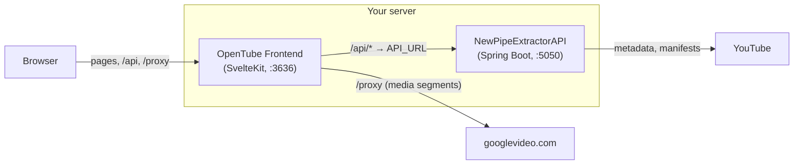

# OpenTube Frontend

[](https://github.com/kl3pt0gr4ph/OpenTube-Frontend/actions/workflows/node.js.yml)
[](https://github.com/kl3pt0gr4ph/OpenTube-Frontend/releases)
[](https://hub.docker.com/r/mrtumble/opentube-frontend)
[](LICENSE)

A self-hosted, privacy-respecting YouTube frontend build with SvelteKit and Shaka Player.

OpenTube lets you search, browse and watch YouTube without a Google account, without tracking, and without your browser ever talking to Google. Pages, API calls and every byte of video are served from your own server. This repository is the web app; it pairs with [NewPipeExtractorAPI](https://github.com/kl3pt0gr4ph/NewPipeExtractorAPI), which does the extraction.

---

## Contents

- [How it works](#how-it-works)
- [Quick start](#quick-start)
- [Configuration](#configuration)
- [Deployment](#deployment)
- [Development](#development)
- [Testing](#testing)
- [Tech stack](#tech-stack)
- [Versioning and releases](#versioning-and-releases)
- [Contributing](#contributing)
- [Related projects](#related-projects)
- [License](#license)

## How it works



This frontend is the only thing a browser talks to. It serves three things from one origin:

| Path       | What it does                                                                                                                                                                                                        |
| ---------- | ------------------------------------------------------------------------------------------------------------------------------------------------------------------------------------------------------------------- |
| `/*`       | The SvelteKit app, server-side rendered by `adapter-node`.                                                                                                                                                          |
| `/api/*`   | A streaming forwarder to the backend at `API_URL`. `GET` only, no cookies or auth forwarded, a 60 s header timeout, and backend redirects refused. Server-side page loads reach it in-process, with no network hop. |
| `/proxy/*` | A streaming media proxy for `*.googlevideo.com`. The player rewrites every segment URL to go through it. Ranges, redirects and aborts are handled here; nothing is buffered.                                        |
| `/health`  | Returns `200 healthy` without calling the backend or rendering a page. Used by the Docker `HEALTHCHECK`.                                                                                                            |

A watch page is loaded like this:

1. The page load fetches details, thumbnails, related items, comments and the DASH manifest from `/api` in parallel. Related items, comments and playlists are optional: if one fails, the page still renders without it.
2. The manifest is handed to Shaka Player, which picks tracks and requests segments.
3. A request filter rewrites each `googlevideo.com` segment URL to `/proxy/…?host=…&range=…`, and the proxy streams the bytes back.
4. If the backend answers with `Content-Type: text/uri-list` instead of a manifest, the video has no usable DASH streams, and the player falls back to a native `<video>` element playing a single progressive MP4, still through the proxy.

## Quick start

You need Docker with the Compose plugin. Save this as `compose.yml`:

```yaml
services:
  frontend:
    image: mrtumble/opentube-frontend:latest
    container_name: opentube-frontend
    restart: unless-stopped
    ports:
      - '3636:3636'
    environment:
      PORT: 3636
      API_URL: http://backend:5050
    depends_on:
      backend:
        condition: service_healthy

  backend:
    image: mrtumble/opentube-backend:latest
    container_name: opentube-backend
    restart: unless-stopped
    environment:
      SERVER_PORT: 5050
```

Then start it:

```bash
docker compose up -d
```

Open <http://localhost:3636>. The backend is not published to the host; only the frontend needs to be reachable.

## Configuration

| Variable           | When it is read | Default  | Description                                                                                                                                                                      |
| ------------------ | --------------- | -------- | -------------------------------------------------------------------------------------------------------------------------------------------------------------------------------- |
| `API_URL`          | Runtime         | –        | **Required.** Address of NewPipeExtractorAPI that `/api` forwards to, e.g. `http://backend:5050`. Must be a plain `http` or `https` URL; the server refuses to start without it. |
| `PORT`             | Runtime         | `3000`   | Port the Node server listens on. The image exposes and health-checks `3636`, so set this to `3636`.                                                                              |
| `PUBLIC_API_URL`   | Build time      | `/api`   | Base URL the app uses for API calls. Baked into the client bundle.                                                                                                               |
| `PUBLIC_PROXY_URL` | Build time      | `/proxy` | Base URL the player sends media requests to. Baked into the client bundle.                                                                                                       |
| `FRONTEND_PORT`    | Dev server only | `5173`   | Port for `npm run dev`.                                                                                                                                                          |

`PUBLIC_*` variables are compiled into the JavaScript at build time, so changing them means rebuilding the image (`--build-arg PUBLIC_API_URL=…`). The published image uses the defaults, which are what you want for a normal deployment. Keep `PUBLIC_API_URL` relative: an absolute URL would make server-side rendering go out over the network instead of calling `/api` in-process.

The usual [adapter-node](https://svelte.dev/docs/kit/adapter-node) runtime variables (`HOST`, `ADDRESS_HEADER`, `XFF_DEPTH` and so on) also apply.

## Deployment

### Behind a reverse proxy

Point a single upstream at the frontend container on port `3636` and route the whole host to it. There is no path rewriting to do and no per-deployment nginx config: `/api`, `/proxy` and `/health` are all served by the app. This works with Traefik, Pangolin, Caddy, nginx or anything else that can proxy HTTP.

If your proxy buffers responses (nginx does by default), turn buffering off for this host so video segments stream straight through.

To let the backend's logs see real visitor addresses, set `ADDRESS_HEADER=X-Forwarded-For` (and `XFF_DEPTH` to the number of proxies in front of the app) on the frontend. The forwarder appends the client address to `X-Forwarded-For` before calling the backend.

### Run the frontend and backend from the same network

YouTube binds the `googlevideo.com` URLs it hands out to the IP address that requested them. The backend extracts the URLs and the frontend fetches the media, so both must reach the internet from the **same public IP**. Running them on the same host, as in the compose file above, satisfies this.

## Development

### Prerequisites

- Node.js 24 or later, with npm
- A running [NewPipeExtractorAPI](https://github.com/kl3pt0gr4ph/NewPipeExtractorAPI) instance, either from its Docker image or from source with Maven

### Setup

```bash
git clone https://github.com/kl3pt0gr4ph/OpenTube-Frontend.git
cd OpenTube-Frontend
npm install
cp .env.example .env
```

`.env.example` points `API_URL` at `http://localhost:8080`, the backend's default port when run with Maven. If you run the backend container instead, change it to `http://localhost:5050`.

```bash
npm run dev
```

The app is at <http://localhost:5173>. Because `/api` and `/proxy` are part of the app, the dev server needs nothing in front of it.

### Building the image locally

```bash
docker build -t opentube-frontend .
```

Pass `--build-arg PUBLIC_API_URL=…` or `--build-arg PUBLIC_PROXY_URL=…` only if you need non-default paths.

## Testing

The unit and component tests use Vitest, split into two projects:

| Project  | Environment | Covers                                                              | Files              |
| -------- | ----------- | ------------------------------------------------------------------- | ------------------ |
| `client` | jsdom       | Svelte components                                                   | `*.svelte.test.ts` |
| `server` | Node        | API clients, adapters, utilities, the `/api` forwarder and `/proxy` | `*.test.ts`        |

```bash
npm run test:client      # components only
npm run test:server      # everything else
npm run test:coverage    # both, with coverage
npm run test:ui          # Vitest's browser UI
```

Coverage is enforced: 85% lines, functions and statements and 80% branches overall, with stricter floors for `src/lib/utils`, `src/lib/adapters` and `src/lib/api`. CI fails if any threshold is missed.

End-to-end tests live in `e2e/` and run against a production build with Playwright. Install the browsers once with `npx playwright install`, then run `npm run test:e2e`.

CI runs lint, type-check, build and the full suite with coverage on every push and pull request to `main`.

## Tech stack

| Area      | Choice                                            |
| --------- | ------------------------------------------------- |
| Framework | SvelteKit 3, Svelte 5, `@sveltejs/adapter-node` 6 |
| Language  | TypeScript 6                                      |
| Styling   | Tailwind CSS 4                                    |
| Player    | Shaka Player 5                                    |
| Build     | Vite 8                                            |
| Testing   | Vitest 5, Testing Library, Playwright             |
| Runtime   | Node.js 24 (Alpine) in Docker                     |
| CI/CD     | GitHub Actions, Dependabot, Docker Hub            |

## Versioning and releases

The frontend is versioned independently of the backend, following [Semantic Versioning](https://semver.org). The rule of thumb: if the person deploying it has to change anything, it's a major release.

Releases are cut by pushing an annotated `vX.Y.Z` tag. The publish workflow checks that `package.json` matches the tag, builds and pushes the Docker image, and creates a GitHub Release from the matching [CHANGELOG.md](CHANGELOG.md) section. The full procedure is in [VERSIONING.md](VERSIONING.md).

When a release needs a particular backend version, its release notes say so.

## Contributing

Issues and pull requests are welcome.

1. Open or pick up an issue first, so the change is agreed before work starts. Each pull request should close one issue.
2. Branch from `main` using `feat/…`, `fix/…`, `refactor/…` or `chore/…`.
3. Before opening the pull request, make sure these pass:

```bash
   npm run lint
   npm run check
   npm run test:coverage
```

4. Add a line under `## [Unreleased]` in [CHANGELOG.md](CHANGELOG.md) for any user-visible change.

## Related projects

- [NewPipeExtractorAPI](https://github.com/kl3pt0gr4ph/NewPipeExtractorAPI): the Spring Boot backend this app talks to
- [NewPipeExtractor](https://github.com/TeamNewPipe/NewPipeExtractor): the extraction library underneath it
- [Shaka Player](https://github.com/shaka-project/shaka-player): the DASH player

## License

Released under the [MIT License](LICENSE).

OpenTube is an independent project and is not affiliated with, endorsed by or connected to YouTube or Google.
